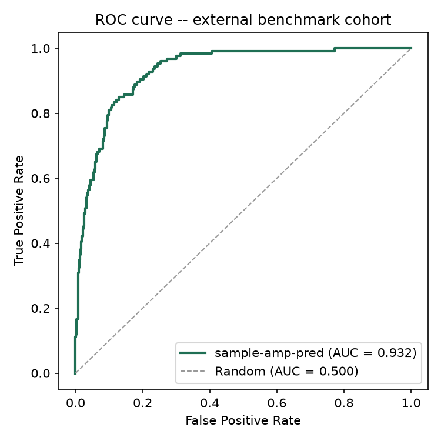
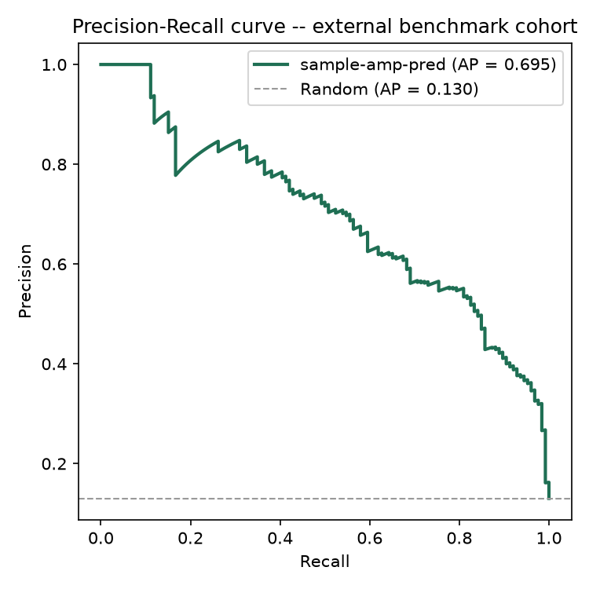
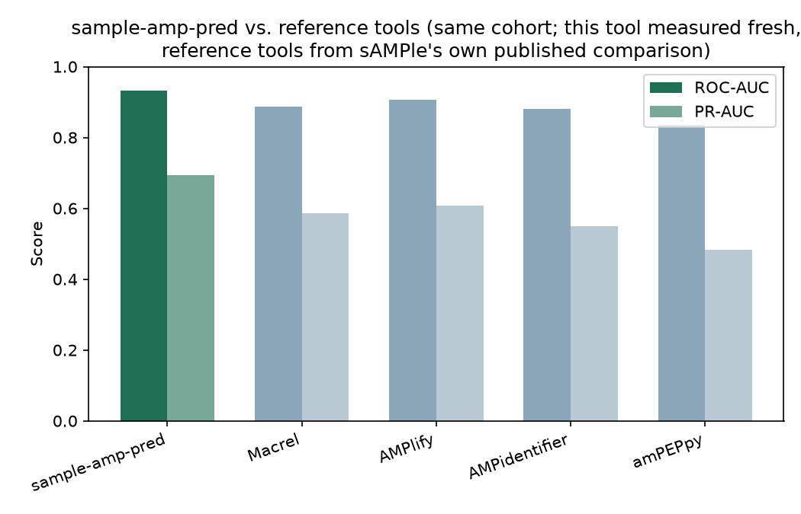

# sample-amp-pred

A small, offline command-line tool that predicts general antibacterial activity for peptide
sequences using the classifier served by [sAMPle](https://sample-database.org), a knowledgebase
and machine-learning platform for bioactive peptides.

The trained model is bundled in this repository as a plain artifact
(`src/sample_amp_pred/data/general_antibacterial_model.pkl`, ~2.2 MB) — no network access, API
key, or the full sAMPle codebase is needed to run a prediction.

## What model this is

sAMPle trains a general antibacterial classifier plus 23 pathogen-specific potency classifiers.
Only the general classifier is served through sAMPle's own web portal and REST API as of
2026-11-25 — the 23 pathogen-specific ones were withdrawn from service after their calibrated
precision proved unreliable at deployment prevalence (see sAMPle's own manuscript for why). This
tool wraps that one served model: an XGBoost classifier, FLAML-searched over 586 features
(400 dipeptide-composition + 147 CTD + 28 amino-acid-composition + 11 physicochemical
descriptors), scored at its trained decision threshold of 0.5.

Held-out performance (13,333 peptides, 69.3% positive, 40% CD-HIT sequence-identity partition
against training): ROC-AUC 0.907, PR-AUC 0.651, precision 0.607, recall 0.623, F1 0.615.

This tool reproduces sAMPle's own feature computation exactly for a linear peptide (verified
bit-for-bit against sAMPle's live inference path on real holdout sequences — see
`CHECKS.md`). The one known gap: sAMPle's own server additionally corrects molecular weight and
net charge for peptides it has independently curated as cyclic or disulfide-bridged; that
curation database is internal to the sAMPle project and is not reproduced here, so every peptide
is scored as a linear chain. This affects only sequences in sAMPle's own curated cyclic-peptide
list, not arbitrary new sequences.

## Install

```bash
pip install .
# or, once published:
pip install sample-amp-pred
```

Requires Python ≥ 3.9. Pulls in `numpy`, `scikit-learn`, `xgboost`, `rdkit`, `peptides`, and
`openpyxl`.

## Usage

```bash
sample-amp-pred -i peptides.fasta -o predictions.csv -f csv -t 0.5
```

| Flag | Meaning | Default |
|---|---|---|
| `-i`, `--input` | Input FASTA file | required |
| `-o`, `--output` | Output file path | required |
| `-f`, `--format` | `csv`, `xlsx`, or `json` | guessed from `-o`'s extension, else `csv` |
| `-t`, `--threshold` | Probability (0–1) at or above which a peptide is labeled `active` | `0.5` (sAMPle's own trained cutoff) |

Every output row carries the predicted **probability**, not just the active/inactive label — the
threshold only decides where the label's cut line sits; the probability is the model's actual
output.

```csv
id,sequence,probability,prediction,error
magainin_2,GIGKFLHSAKKFGKAFVGEIMNS,0.9058,active,
too_short,A,,error,sequence too short to score (minimum 2 residues)
```

A sequence this tool cannot score (too short, or carrying a non-standard residue) still gets a
row — with `prediction=error` and the reason in the `error` column — rather than being silently
dropped, so the output always has one row per FASTA entry.

## Benchmark results

`sample-amp-pred` was run, as-is, against an external-benchmark cohort of 968 peptides (126
active, 13.0% prevalence) — the same 40%-CD-HIT-partitioned holdout sAMPle's own manuscript
compares against Macrel, AMPlify, AMPidentifier and amPEPpy. The dataset, predictions, metrics,
and the plots below all live in [`benchmarks/`](benchmarks/) as repository artifacts, not just
numbers in this table — see [`benchmarks/README.md`](benchmarks/README.md) for exactly how each
file was produced and how to reproduce it with only this package installed.

| Metric | Value |
|---|---|
| ROC-AUC | 0.932 |
| PR-AUC | 0.695 |
| Accuracy | 0.903 |
| Precision | 0.629 |
| Recall | 0.619 |
| Specificity | 0.945 |
| F1 | 0.624 |
| MCC | 0.568 |

<p>
  
  
  
</p>

The third plot places this alongside sAMPle's own published comparison against four external AMP
predictors on the same cohort (context only — this package has no per-sequence scores for those
tools, so it cannot re-run that half; see `benchmarks/results.md`):

| Tool | ROC-AUC | PR-AUC |
|---|---|---|
| **sample-amp-pred (measured here)** | **0.932** | **0.695** |
| Macrel | 0.887 | 0.585 |
| AMPlify | 0.907 | 0.607 |
| AMPidentifier | 0.881 | 0.549 |
| amPEPpy | 0.836 | 0.483 |

These numbers match sAMPle's own published ones for this model on this cohort to 4 decimal
places on every threshold-dependent metric (accuracy/precision/recall/F1/MCC), and within ~0.001
on the threshold-free ones (ROC-AUC/PR-AUC) — see `benchmarks/results.md` for the one documented,
expected source of that last thousandth.

## Development

```bash
pip install -e ".[dev]"
pytest
```

## Provenance

The bundled model was exported from sAMPle's `data/sample_final_release/models/antibacterial/
general/any/classification/flaml.pkl` by stripping it to the three things this tool needs — the
fitted `xgboost.XGBClassifier`, its 586 training column names, and its calibrated threshold — so
loading it needs no dependency on the sAMPle codebase itself. See
[sample-database.org](https://sample-database.org) for the full platform, dataset, and the other
served/withdrawn models' own methodology.

## License

MIT (see `LICENSE`). The bundled model's training data and methodology belong to the sAMPle
project.
